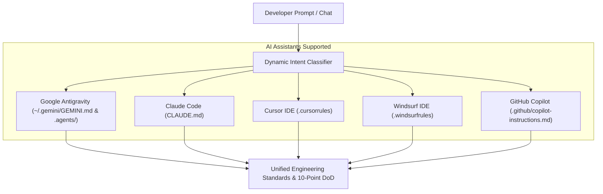

# UNIVERSAL COGNITIVE OPERATING SYSTEM (AGY-OS)
## Cross-IDE Production Engineering Suite for Antigravity, Claude Code, Cursor, Windsurf & Copilot

Welcome to your **universal, stateful, out-of-the-box development operating system**.

This repository is pre-configured to transform **any AI-integrated IDE or CLI assistant** into a **conscious Principal Systems Architect, Staff Full-Stack Engineer, and Lead Technical Product Strategist**. It enforces market-leading standards across all languages (TypeScript, Python, Java 21, Go, Rust, C#) and all disciplines (Frontend, Backend, Databases, Microservices, Multi-Agent Systems, and the 8-Level Testing Pyramid).

---

## 🌐 UNIVERSAL CROSS-IDE COMPATIBILITY

This setup works out-of-the-box across **every modern AI-integrated IDE**:



| AI Assistant / IDE | Integration File | Configuration Mechanism |
| :--- | :--- | :--- |
| **Google Antigravity** | [`~/.gemini/GEMINI.md`](file:///C:/Users/bobharsh/.gemini/GEMINI.md) & [`.agents/`](file:///c:/Users/bobharsh/Downloads/IDE%20config/.agents) | Global Constitution + Project Skills, Rules, and Workflows |
| **Claude Code** | [`CLAUDE.md`](file:///c:/Users/bobharsh/Downloads/IDE%20config/CLAUDE.md) | Auto-injected at project root on every CLI session |
| **Cursor IDE** | [`.cursorrules`](file:///c:/Users/bobharsh/Downloads/IDE%20config/.cursorrules) | Project root rules automatically loaded by Cursor Agent |
| **Windsurf (Codeium)** | [`.windsurfrules`](file:///c:/Users/bobharsh/Downloads/IDE%20config/.windsurfrules) | Root rules automatically loaded by Windsurf Cascade |
| **GitHub Copilot** | [`.github/copilot-instructions.md`](file:///c:/Users/bobharsh/Downloads/IDE%20config/.github/copilot-instructions.md) | Workspace rules recognized by Copilot Chat & Workspace |

---

## ⚡ 3-GEAR DYNAMIC TRANSMISSION: JUST SPEAK NATURALLY

You **do not need to memorize prompt numbers or type out complex flags**. The system's **3-Gear Transmission** automatically detects task scope, selects the right speed gear, loads the matching playbook, and enforces the standards:

| Gear | Trigger / Example | What the AI Automatically Executes | Reference Engine |
| :--- | :--- | :--- | :--- |
| **Gear 1: Fast Path** | `qs: write a regex for email` | **Sub-2s Minimal Output**: Concise, direct code. Zero DoD checklists or scaffolding. | Zero-Boilerplate Fast Path |
| **Gear 2: Tactical** | `mod: add phone input to profile` | **Surgical Single-Tier**: Modifies target component only. Strict types + test. Zero unrequested DB/backend scaffolding. | Tactical Surgical Mode |
| **Gear 3: Strategic** | *"Here's my design doc: [spec]"* | **Requirements Scoping**: In-Scope vs. Non-Goals; generates INVEST BDD User Stories. | [`prd-to-stories`](file:///c:/Users/bobharsh/Downloads/IDE%20config/.agents/skills/prd-to-stories/SKILL.md) / `02_prd_scoping...` |
| **Gear 3: Strategic** | *"Implement US-02 in Next.js & PG"* | **Production Story Solver**: Enforces the 10-Point Production DoD (Zod, ACID DB, 4-state UI, a11y, tests). | [`solve-user-story`](file:///c:/Users/bobharsh/Downloads/IDE%20config/.agents/skills/solve-user-story/SKILL.md) / `15_solve_user_story...` |
| **Maintenance** | `/compact` | **Context Compaction**: Syncs architectural decisions & stories to `.agents/STATE.md`; purges memory clutter. | State Ledger Sync |
| **Audit & Review** | *"Review this PR for security"* | **7-Pillar Audit**: OWASP Top 10, concurrency, N+1 queries, memory leaks, strict types. | [`production-code-reviewer`](file:///c:/Users/bobharsh/Downloads/IDE%20config/.agents/skills/production-code-reviewer/SKILL.md) / `09_debugging...` |
| **Diagnosis** | *"Why is this query slow / crashing?"*| **Root Cause Analysis (RCA)**: 5-Whys diagnosis, minimal hotfix, regression test. | [`production-code-reviewer`](file:///c:/Users/bobharsh/Downloads/IDE%20config/.agents/skills/production-code-reviewer/SKILL.md) / `09_debugging...` |

---

## 📁 REPOSITORY STRUCTURE WALKTHROUGH

Every folder is cleanly named, modular, and human-readable:

```text
IDE config/
├── AGENTS.md                           # Universal project rules (Antigravity, Gemini CLI)
├── CLAUDE.md                           # Universal project rules (Claude Code CLI)
├── .cursorrules                        # Universal project rules (Cursor IDE)
├── .windsurfrules                      # Universal project rules (Windsurf IDE)
├── .github/
│   └── copilot-instructions.md         # Universal project rules (GitHub Copilot)
│
├── .agents/
│   ├── STATE.md                        # Living situational awareness ledger (current sprint & stack)
│   ├── rules/
│   │   └── AGENTS.md                   # Project execution rules enforcing the 10-Point DoD
│   ├── skills/                         # 8 Lean execution runbooks (Progressive Disclosure)
│   │   ├── prd-to-stories/             # Scoping & INVEST BDD User Stories
│   │   ├── system-architect/           # C4 models, DB schema, scaling analysis, ADRs
│   │   ├── production-code-reviewer/   # 7-pillar audit (OWASP, concurrency, N+1 queries)
│   │   ├── universal-state-tracker/    # Project state ledger synchronization
│   │   ├── deep-search-and-execute/    # Autonomous search & thread execution
│   │   ├── multiagent-orchestrator/    # Supervisor/worker DAG subagent delegation
│   │   ├── quality-engineering-and-testing/ # Polyglot testing pyramid (Testcontainers, k6)
│   │   └── solve-user-story/           # End-to-end story solver with 10-point DoD
│   └── references/                     # 14 On-Demand Domain Reference Playbooks
│       ├── coder-auditor-review-loop.md      # Autonomous Actor-Critic review & remediation loop
│       ├── master-engineering-checklist.md   # Exhaustive technical verification matrix
│       ├── interlinked-fullstack-workflow.md # Type SSOT, mutation & trace propagation
│       ├── production-definition-of-done.md  # The 10-Point Non-Negotiable Standard
│       ├── polyglot-language-standards.md    # Idiomatic TS, Python, Java 21, Go 1.22, Rust, C#
│       ├── enterprise-testing-pyramid.md     # 8-level testing: Unit, Testcontainers, k6
│       ├── microservices-architecture.md     # Bounded Contexts, Sagas, Outbox, gRPC, OTel
│       ├── multiagent-systems.md             # MAS topologies, memory tiers, A2A protocols
│       ├── frontend-standards.md             # React/Next/Vue, WCAG AA/AAA, Core Web Vitals
│       ├── backend-api-standards.md          # Hexagonal, RFC 7807, Idempotency, Cursor pagination
│       ├── database-storage-standards.md     # 3NF, UUIDv7, B-tree/GIN, Redis cache stampedes
│       ├── cloud-devops-standards.md         # Multi-stage Docker, K8s probes, Terraform IAM
│       ├── ai-ml-genai-standards.md          # Structured outputs, Hybrid RAG, Agent guardrails
│       └── data-engineering-standards.md      # Modern ELT, dbt DAGs, Spark optimization
│
├── prompts/                            # 17 Zero-Conflict Master Prompts (with README guide)
│   ├── README.md                       # Master Prompt Catalog & Dynamic Intent Cheatsheet
│   ├── 01_architecture_and_system_design.md
│   ├── 02_prd_scoping_and_user_stories.md
│   ├── ...
│   ├── 15_solve_user_story_production_grade.md
│   ├── 16_autonomous_fullstack_master_execution.md
│   └── 17_coder_auditor_self_healing_review.md
│
├── templates/                          # Reusable Industry-Standard Templates
│   ├── README.md                       # Template Catalog & Usage Guide
│   ├── ADR_TEMPLATE.md                 # Architecture Decision Record
│   ├── PRD_TEMPLATE.md                 # Product Requirements Document
│   ├── STATE_TEMPLATE.md               # Project State Ledger
│   ├── USER_STORY_TEMPLATE.md          # INVEST + Gherkin BDD format
│   └── API_CONTRACT_TEMPLATE.md        # RFC 7807 Problem Details specification
│
└── mcp/                                # Model Context Protocol (MCP) Tool Configurations
    ├── README.md                       # Setup instructions for Memory, Fetch, Postgres, GitHub
    └── mcp_config.json                 # Pre-configured MCP server manifest
```

---

## 🛡️ THE 10-POINT PRODUCTION DEFINITION OF DONE (DoD)

Whenever any AI in any IDE implements a feature or user story in this repository, it is held to the **10-Point DoD**:

1. **Defensive Validation**: Ingress schema verification (Zod/Pydantic) before business logic.
2. **Authorization & IDOR**: Session-derived tenant/user checks on every object read/write.
3. **Atomic Data & Indexes**: Explicit ACID transactions on multi-table writes; composite B-Tree indexes.
4. **Concurrency & Idempotency**: `Idempotency-Key` headers for mutations; optimistic/pessimistic locking.
5. **RFC 7807 Errors**: Structured `{ type, title, status, detail, instance }` payloads (zero blank 500s).
6. **Timeouts & Cancellation**: Explicit HTTP/RPC timeouts; `ctx.Done()` / `AbortController` propagation.
7. **Frontend 4-State UI**: Loading skeleton (fixed aspect ratio), Empty state (with CTA), Error state (with retry), Populated state.
8. **Accessibility & Core Web Vitals**: WCAG 2.1 AA/AAA keyboard navigation, ARIA labels, zero layout shifts ($\text{CLS} < 0.1$).
9. **Deterministic Tests**: Boundary unit tests (null, empty, negative, max limits) + real DB integration tests (Testcontainers).
10. **Telemetry & State Sync**: Structured JSON logs with trace correlation; updates [`.agents/STATE.md`](file:///c:/Users/bobharsh/Downloads/IDE%20config/.agents/STATE.md).

---

## 🚀 HOW TO DEPLOY TO ANY PROJECT IN 10 SECONDS

To endow **any new or existing project** with this universal setup:

1. Copy `.agents/` and the root IDE files into your target repository root:
   ```powershell
   Copy-Item -Recurse "C:\Users\bobharsh\Downloads\IDE config\.agents" "C:\path\to\your\project\"
   Copy-Item "C:\Users\bobharsh\Downloads\IDE config\CLAUDE.md" "C:\path\to\your\project\"
   Copy-Item "C:\Users\bobharsh\Downloads\IDE config\.cursorrules" "C:\path\to\your\project\"
   Copy-Item "C:\Users\bobharsh\Downloads\IDE config\.windsurfrules" "C:\path\to\your\project\"
   Copy-Item "C:\Users\bobharsh\Downloads\IDE config\AGENTS.md" "C:\path\to\your\project\"
   ```
2. Open the project in Antigravity, Cursor, Claude Code, Windsurf, or VS Code.
3. The AI assistant will immediately boot with full cognitive consciousness, dynamic intent detection, and production standards.
